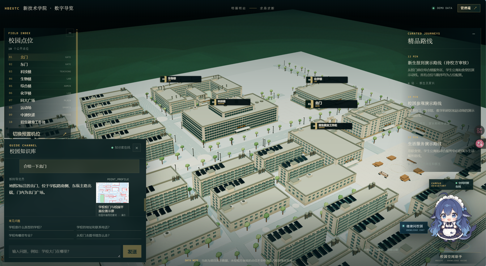
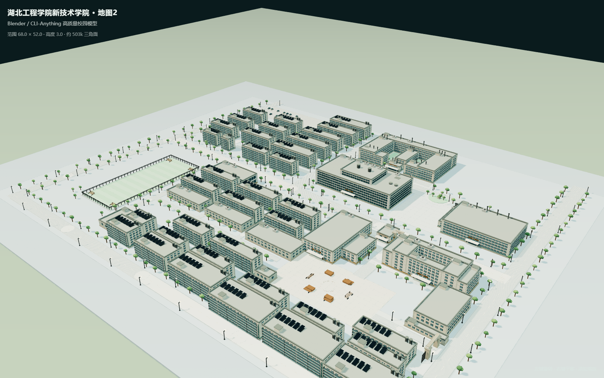
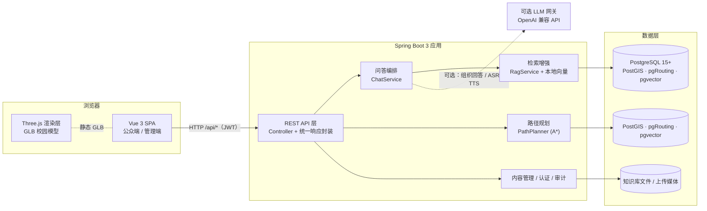

<div align="center">

# AI Campus Guide

**AI 数字人校园导览系统**

三维校园漫游 · 数字人讲解 · 可信知识库问答 · 步行导航

[](https://vuejs.org/)
[](https://www.typescriptlang.org/)
[](https://vite.dev/)
[](https://threejs.org/)
[](https://spring.io/projects/spring-boot)
[](https://openjdk.org/)
[](https://www.postgresql.org/)
[](#贡献指南)

</div>

---

## 项目简介

**AI Campus Guide** 是一套前后端完全解耦的校园导览 Web 系统。它把「三维校园模型」当作空间底座，把「数字人」当作交互人格，把「已审核知识库」当作回答依据，让访客在浏览器里就能完成**逛校园、听讲解、问问题、找路线**这一整条动线。

系统面向两类使用者：

- **访客 / 新生 / 考生家长**：拖拽漫游三维校园，点击建筑听讲解，用自然语言提问，获得带来源引用的答案与逐段步行导航。
- **校方运营人员**：在管理端维护点位、路网、精品路线、预置机位、FAQ、知识库、系统参数与问答日志。

> **设计原则：宁可拒答，也不编造。** 问答链路的回答只能来自「FAQ 精确命中 → 知识库向量检索 → 已审核点位数据」三级可信来源；没有依据时返回明确的拒答提示，而不是让大模型自由发挥。

> **In short** — AI Campus Guide is a fully decoupled Vue 3 + Spring Boot campus guide that combines a Three.js 3D campus, an SVG digital-human host, retrieval-augmented Q&A with source citations, and A*/pgRouting walking directions. The backend exposes REST APIs, JWT auth and a full admin console for points, road network, tours, knowledge base and analytics.

---

## 界面预览

<p align="center">
  
</p>

<p align="center"><sub><b>系统三维可视化预览页</b> · 公众端三维导览界面（2544 × 1396）</sub></p>

### 三维场景细节

<table>
  <tr>
    <td width="50%"></td>
    <td width="50%"></td>
  </tr>
  <tr>
    <td align="center"><sub>三维校园总览</sub></td>
    <td align="center"><sub>浏览器内实时渲染</sub></td>
  </tr>
  <tr>
    <td width="50%"></td>
    <td width="50%"></td>
  </tr>
  <tr>
    <td align="center"><sub>门区与广场</sub></td>
    <td align="center"><sub>教学建筑群</sub></td>
  </tr>
</table>

---

## 目录

- [项目简介](#项目简介)
- [界面预览](#界面预览)
- [核心功能](#核心功能)
- [系统架构](#系统架构)
- [技术栈](#技术栈)
- [快速开始](#快速开始)
- [数据库](#数据库)
- [构建环境规范](#构建环境规范)
- [配置说明](#配置说明)
- [API 文档](#api-文档)
- [测试](#测试)
- [目录结构](#目录结构)
- [三维建模管线](#三维建模管线)
- [生产部署](#生产部署)
- [已知限制](#已知限制)
- [故障排查](#故障排查)
- [路线图](#路线图)
- [贡献指南](#贡献指南)
- [许可证](#许可证)
- [致谢](#致谢)

---

## 核心功能

### 访客端

| 功能 | 说明 |
| --- | --- |
| **三维校园漫游** | 约 50 万三角面的 GLB 场景，支持轨道漫游、缩放与预置机位切换；模型加载失败时自动降级为程序化兜底场景，页面不会白屏。 |
| **建筑点选与讲解** | 点击建筑或左侧点位列表，镜头沿贝塞尔路径飞行到目标，同步高亮建筑并触发数字人指引手势与语音讲解。 |
| **数字人导览** | SVG 数字人具备待机呼吸、挥手、指引三种动作状态，随回答内容与场景动作联动，不依赖外部视频或 3D 角色资源。 |
| **可信知识问答** | FAQ 精确/模糊命中 → 本地向量检索 → 已审核点位数据，逐级降级；回答附带 `sources` 来源引用，无依据时明确拒答。 |
| **步行导航** | 基于校园路网做最短路规划，输出逐段中文指令、分段距离、总距离与预计步行时间，并在三维场景中高亮路线。 |
| **精品路线** | 校方预设讲解动线，支持自动播放、暂停、上一站/下一站；访客中途提问时自动暂停，回答结束后自动续播。 |
| **侧栏可折叠** | 点位栏与路线栏均可收起为窄条，桌面端互不影响，移动端互斥切换，为三维视图让出最大可视面积。 |
| **反馈闭环** | 每条回答支持「有帮助 / 没帮助 / 信息过时」反馈，写入日志供运营侧分析。 |

### 管理端

| 功能 | 说明 |
| --- | --- |
| **点位管理** | 增删改查校园点位，维护坐标、建筑高度、配色、模型 Key、路网节点绑定与发布状态。 |
| **路网管理** | 维护路网节点与带权边，作为路径规划的数据基础。 |
| **路线管理** | 编排精品路线的站点顺序与讲解词。 |
| **机位管理** | 保存/调整预置相机机位（位置、朝向、视场角）。 |
| **FAQ 管理** | 维护高频问答对，作为问答链路的第一优先级来源。 |
| **知识库管理** | 上传 PDF / Word / Markdown / 纯文本等资料，Apache Tika 自动解析，按 420 字滑窗切块并建立向量索引；支持发布与重建索引。 |
| **运营分析** | 问答日志、反馈统计、审计日志查询。 |
| **参数与权限** | 系统参数在线调整；基于 JWT + 注解式 RBAC 的四级角色权限。 |

---

## 系统架构



---

## 技术栈

### 前端

| 技术 | 版本 | 用途 |
| --- | --- | --- |
| [Vue 3](https://vuejs.org/) | 3.5 | 组合式 API 构建公众端与管理端界面 |
| [TypeScript](https://www.typescriptlang.org/) | 6.0 | 全量类型约束，前后端 DTO 对齐 |
| [Vite](https://vite.dev/) | 8.3 | 开发服务器、构建与 `/api` 代理 |
| [Vue Router](https://router.vuejs.org/) | 5.4 | 公众端 / 管理端路由与登录守卫 |
| [Three.js](https://threejs.org/) | 0.187 | GLB 场景加载、相机飞行、射线拾取、路线高亮 |
| [Vitest](https://vitest.dev/) | 5.1 | 组件单元测试（jsdom 环境） |

**为什么这么选**：Three.js 直连 WebGL，不需要引入完整游戏引擎即可满足「几万面到几十万面静态场景 + 点选 + 镜头动画」的需求；Vite 的冷启动和 HMR 让三维调试的迭代成本显著降低。

### 后端

| 技术 | 版本 | 用途 |
| --- | --- | --- |
| [Spring Boot](https://spring.io/projects/spring-boot) | 3.5.3 | Web、校验、Actuator、任务调度 |
| [Java](https://openjdk.org/) | 17 | LTS 运行时 |
| [MyBatis-Plus](https://baomidou.com/) | 3.5.7 | 数据访问与分页 |
| [Flyway](https://flywaydb.org/) | 跟随 Boot | 多数据库版本化迁移 |
| [JJWT](https://github.com/jwtk/jjwt) | 0.12.6 | 管理端 JWT 签发与校验 |
| [Apache Tika](https://tika.apache.org/) | 3.2.3 | 知识库文档解析（PDF / Office / 文本） |
| [springdoc-openapi](https://springdoc.org/) | 2.8.17 | OpenAPI 3 文档生成 |
| [Knife4j](https://doc.xiaominfo.com/) | 4.5.0 | 中文友好的接口调试 UI |

### 数据与算法

| 技术 | 用途 |
| --- | --- |
| **PostgreSQL 15+** | 生产数据库 |
| **PostGIS** | 空间字段与距离计算 |
| **pgRouting** | 数据库内最短路查询 |
| **pgvector** | 知识块向量检索 |
| **H2** | 仅 `test` 作用域：单元测试内存数据库 |
| **本地向量哈希** | 256 维特征哈希，无需外部 Embedding 服务即可跑通 RAG |
| **A\* 路径规划** | 无 pgRouting 时的内存兜底实现 |

### 建模

| 技术 | 用途 |
| --- | --- |
| **Blender 5.2** | 建筑体量、材质、灯光与渲染 |
| **Python + bpy** | 参数化建模脚本（`tools/campus_map2/`） |
| **glTF / GLB** | 运行时模型格式 |

---

## 构建环境规范

| 项 | 标准 | 说明 |
| --- | --- | --- |
| JDK | 17（本仓库以 Amazon Corretto 17.0.21 验证） | Spring Boot 3.5 要求 17+ |
| 构建工具 | **仓库自带 Maven Wrapper（3.9.11）** | 任何机器执行 `./mvnw` 即可获得一致版本，无需全局安装 Maven |
| Maven 版本下限 | 3.6.3 | Spring Boot 3.5 管理的插件（如 maven-compiler-plugin 3.14）硬性要求 3.6.3+，3.6.1 等旧版会直接构建失败 |
| 前端 | Node 20+ / npm 10+ | `npm ci` 依据 `package-lock.json` 锁定依赖 |
| 依赖镜像 | 可选阿里云镜像 | 见 `docs/04-deployment/maven-settings-aliyun.xml`，仅加速下载，不改变依赖清单 |

### IntelliJ IDEA 配置

1. `Settings → Build, Execution, Deployment → Build Tools → Maven`：Maven home path 选择 **Use Maven wrapper**（或本地 3.6.3+ 的 Maven）。
2. `Project Structure → Project SDK`：选择 corretto-17.0.21，Language level 17。
3. 右键 pom.xml → Maven → Reload Project；依赖全部来自 `pom.xml`，无需手工导 jar。

### 换电脑部署

1. 安装 JDK 17 与 Node 20+；
2. 克隆仓库后直接 `backend\mvnw.cmd package` 与 `frontend\npm ci`，Wrapper 与 lockfile 保证依赖版本一致；
3. 按[数据库](#数据库)一节准备 PostgreSQL 即可启动。

## 快速开始

### 环境要求

| 依赖 | 版本 | 是否必需 |
| --- | --- | --- |
| JDK | 17+ | 必需 |
| Node.js | 20+（建议 22） | 必需 |
| npm | 10+ | 必需 |
| PostgreSQL + PostGIS + pgRouting + pgvector | 14+（建议 15+） | 必需（可用仓库便携版） |

连接方式与环境变量见[数据库](#数据库)一节；工具链要求见[构建环境规范](#构建环境规范)。

### 1. 克隆仓库

```bash
git clone https://github.com/<your-name>/ai-campus-guide.git
cd ai-campus-guide
```

### 2. 启动后端

```bash
cd backend
./mvnw clean package -DskipTests      # Windows: .\mvnw.cmd clean package -DskipTests
java -jar target/campus-guide-1.0.0.jar
```

后端启动于 `http://localhost:8080`，健康检查：`GET /actuator/health`。

### 3. 启动前端

另开一个终端：

```bash
cd frontend
npm ci
npm run dev
```

### 4. 访问

| 入口 | 地址 |
| --- | --- |
| 公众端（三维导览） | http://127.0.0.1:5173/ |
| 管理端登录 | http://127.0.0.1:5173/admin/login |
| 独立模型预览页 | http://127.0.0.1:5173/campus-viewer.html |
| 后端健康检查 | http://127.0.0.1:8080/actuator/health |
| 接口调试（Knife4j） | http://127.0.0.1:8080/doc.html |

> **演示账号**：`admin`、`editor`、`reviewer`、`analyst`，密码均为 `Demo@123`。
> 上线前必须修改密码与 JWT 密钥。

### 分开运行（推荐日常开发）

前端与后端各自独立生命周期，由三个脚本管理：

```powershell
scripts\start-backend.ps1     # PostgreSQL（按需）+ 后端 :8080，缺 jar 自动构建
scripts\start-frontend.ps1    # 前端 :5173，缺 node_modules 自动 npm ci
scripts\stop.ps1              # 停止前后端（默认保留 PostgreSQL；-IncludeDatabase 全停）
```

两个进程完全解耦：前端通过 Vite 代理把 `/api` 转发到 `VITE_API_PROXY_TARGET`（默认 `http://localhost:8080`）；后端 CORS 已放行 `localhost:5173` 与 `127.0.0.1:5173`。改端口并行运行示例：

```powershell
scripts\start-backend.ps1  -Port 9080
scripts\start-frontend.ps1 -Port 5174 -ApiTarget http://localhost:9080
```

一条命令全部拉起用 `scripts\start-all.ps1`（旧 `start-optimized.ps1` 保留为兼容入口）。

### 在 IDE 中分开运行（IntelliJ IDEA + VS Code）

两个目录互不依赖，可以各用一个 IDE 打开、各自启动：

**后端 · IntelliJ IDEA**

1. `File → Open` 选择 `backend/` 目录，作为独立工程打开。
2. `Settings → Build, Execution, Deployment → Build Tools → Maven`：Maven home 选 **Use Maven wrapper** 或本地 Maven 3.9.11（二者同版本；不要选 3.6.1 等旧版）；`Project Structure → SDK` 选 corretto-17.0.21。
3. 确认数据库在跑：IDEA 终端执行 `.\scripts\start-postgres.ps1`，或确认 55432 端口已在监听。
4. 右键 `CampusGuideApplication` → **Run**；默认端口 8080，启动时自动执行 Flyway 迁移。

**前端 · VS Code**

1. 打开 `frontend/` 目录；推荐安装扩展 **Vue - Official（Volar）**。
2. 终端执行 `npm ci`（首次）→ `npm run dev`；默认 5173，`/api` 自动代理到 `http://localhost:8080`。

**注意事项**

- 同一端口只能有一个实例：从 IDE 启动前先执行 `scripts\stop.ps1`，避免端口占用。
- 换端口并行：IDEA Run Configuration 环境变量 `SERVER_PORT=9080`；前端 `npm run dev -- --port 5174` 并设 `VITE_API_PROXY_TARGET=http://localhost:9080`。
- 后端在 IDEA 中以 `backend/` 为工作目录运行，上传目录 `./data/uploads` 会落在 `backend/data/uploads`（已被 gitignore）。

---

## 数据库

系统以 **PostgreSQL（含 PostGIS / pgRouting / pgvector）** 作为唯一运行时数据库。仓库只保留一套 Flyway 迁移（`backend/src/main/resources/db/migration`，V1–V8），启动时自动执行；H2 仅以 `test` 作用域存在于单元测试中，不参与运行。

### 启动数据库

方式一：仓库自带的便携版 PostgreSQL 脚本（含三个扩展，适合教室 / 答辩等零配置环境）。**双实例约定（本机）**：D 盘安装的服务版 PostgreSQL（5432）供其他项目使用，不要在其上创建 campus_guide 库或执行迁移，避免混库。

```powershell
backend\scripts\start-postgres.ps1        # 默认端口 55432
```

方式二：使用已安装的 PostgreSQL，先建库与扩展：

```sql
CREATE DATABASE campus_guide;
-- 连接到 campus_guide 后执行
CREATE EXTENSION postgis;
CREATE EXTENSION pgrouting;
CREATE EXTENSION vector;
```

### 连接配置

| 变量 | 默认值 | 说明 |
| --- | --- | --- |
| `POSTGRES_URL` | — | 设置后整体覆盖 JDBC URL |
| `PG_PORT` | `55432` | 端口（自建实例通常为 5432） |
| `PG_DB` | `campus_guide` | 库名 |
| `POSTGRES_USER` | `postgres` | 用户名 |
| `POSTGRES_PASSWORD` | `123456` | 密码，**生产必改** |
| `PG_POOL_MAX` | `10` | HikariCP 连接池上限 |

启动时 `DatabaseCapabilities` 会探测 `postgis_version()` 与 `pgr_version()`：扩展齐全时启用空间建筑与 pgRouting 最短路；缺失时自动降级为内存 A*，不会启动失败。

---


## 配置说明

后端全部配置都可通过环境变量覆盖：

| 变量 | 默认值 | 说明 |
| --- | --- | --- |
| `SERVER_PORT` | `8080` | 后端监听端口 |
| `APP_JWT_SECRET` | 演示密钥 | JWT 签名密钥，**生产必改**（≥ 32 字符） |
| `APP_JWT_TTL_MINUTES` | `480` | Token 有效期（分钟） |
| `APP_CORS_ORIGIN` | `http://localhost:5173` | 允许的前端来源 |
| `APP_CORS_ORIGIN_ALT` | `http://127.0.0.1:5173` | 备用来源 |
| `APP_UPLOAD_DIR` | `./data/uploads` | 知识库/媒体上传目录 |
| `APP_MAX_FILE_BYTES` | `52428800` | 单文件上限（50 MB） |
| `KNIFE4J_ENABLED` | `true` | 是否开放接口文档，**生产建议 `false`** |
| `AI_ENABLED` | `false` | 是否启用外部 LLM / ASR / TTS |
| `AI_BASE_URL` | `https://api.openai.com/v1` | OpenAI 兼容网关地址 |
| `AI_API_KEY` | 空 | 网关密钥 |
| `AI_CHAT_MODEL` | `gpt-4.1-mini` | 对话模型 |
| `AI_ASR_MODEL` | `whisper-1` | 语音识别模型 |
| `AI_TTS_MODEL` | `gpt-4o-mini-tts` | 语音合成模型 |
| `AI_TTS_VOICE` | `alloy` | 合成音色 |

前端配置（构建时注入）：

| 变量 | 说明 |
| --- | --- |
| `VITE_API_BASE_URL` | API 根地址；同源部署或走 Vite 代理时留空 |
| `VITE_API_PROXY_TARGET` | 开发代理目标，默认 `http://localhost:8080` |

> `AI_ENABLED=false` 时系统仍可完整运行：问答走 FAQ + 本地向量检索，语音相关接口返回明确的未启用提示。

---

## API 文档

启动后端后访问 **Knife4j**：<http://localhost:8080/doc.html>

原始 OpenAPI JSON：`GET /v3/api-docs`

### 主要接口

| 分组 | 方法 | 路径 | 说明 |
| --- | --- | --- | --- |
| 认证 | `POST` | `/api/auth/login` | 管理端登录，返回 JWT |
| 公开导览 | `GET` | `/api/public/bootstrap` | 一次性拉取点位、建筑、路网、路线、机位与配置 |
| 公开导览 | `GET` | `/api/public/points` | 点位列表 |
| 公开导览 | `GET` | `/api/public/tours` | 精品路线列表 |
| 公开导览 | `POST` | `/api/public/chat` | 数字人问答（含场景指令与来源引用） |
| 公开导览 | `POST` | `/api/public/feedback` | 回答反馈 |
| 公开导览 | `POST` | `/api/public/asr` | 语音识别（需启用 AI） |
| 公开导览 | `POST` | `/api/public/tts` | 语音合成（需启用 AI） |
| 内容管理 | `GET/POST/PUT/DELETE` | `/api/admin/points` | 点位维护 |
| 内容管理 | `GET/POST/DELETE` | `/api/admin/roads/**` | 路网节点与边维护 |
| 内容管理 | `GET/POST/PUT` | `/api/admin/tours` | 精品路线维护 |
| 内容管理 | `GET/POST/PUT` | `/api/admin/cameras` | 预置机位维护 |
| 内容管理 | `GET/POST/PUT/DELETE` | `/api/admin/faqs` | FAQ 维护 |
| 内容管理 | `GET/POST/PUT/DELETE` | `/api/admin/knowledge` | 知识库文档上传、发布、重建索引 |
| 内容管理 | `GET/PUT` | `/api/admin/configs` | 系统参数 |
| 数据分析 | `GET` | `/api/admin/stats` | 运营统计 |
| 数据分析 | `GET` | `/api/admin/chat-logs` | 问答日志 |
| 数据分析 | `GET` | `/api/admin/audit-logs` | 审计日志 |

### 统一响应结构

```json
{
  "code": 0,
  "message": "success",
  "data": {},
  "traceId": "b7f3c1d9a2e4",
  "timestamp": "2026-01-01T10:00:00Z"
}
```

`code = 0` 表示业务成功；非 0 时由 `ErrorCode` 给出稳定的业务错误标识，`traceId` 可关联服务端日志。

### 调用示例

```bash
curl -X POST http://localhost:8080/api/public/chat \
  -H "Content-Type: application/json" \
  -d '{"sessionId":"demo-session","message":"从校门去图书馆怎么走？","currentPointId":1}'
```

---

## 测试

```bash
# 前端：单元测试 + 类型检查 + 生产构建
cd frontend
npm test
npm run build

# 后端：单元测试与集成测试
cd backend
./mvnw test          # Windows: .\mvnw.cmd test
```

覆盖重点：

- 前端：侧栏折叠/互斥切换、聊天气泡渲染、数字人状态机。
- 后端：意图识别、文本切块、本地向量、A\* 路径规划、OpenAPI 文档生成、接口文档禁用开关。

---

## 目录结构

```text
ai-campus-guide/
├── frontend/                      独立 Vue 3 SPA
│   ├── public/
│   │   └── models/                运行时 GLB 与独立预览页
│   ├── src/
│   │   ├── api/                   统一 API 客户端
│   │   ├── components/            三维场景、数字人、对话面板
│   │   ├── views/                 公众端 / 管理端 / 登录页
│   │   └── router.ts              路由与登录守卫
│   └── README.md
├── backend/                       独立 Spring Boot REST API
│   ├── src/main/java/
│   │   ├── controller/            REST 接口
│   │   ├── service/               业务编排（问答、检索、路径、内容）
│   │   ├── algorithm/             意图识别、向量、分块、A*
│   │   ├── domain/                领域模型
│   │   └── config/                安全、CORS、OpenAPI、演示数据
│   ├── src/main/resources/
│   │   ├── db/migration/          Flyway 迁移（V1–V8，PostgreSQL 唯一真源）
│   │   └── application.yml
│   └── README.md
├── tools/campus_map2/             可复现的三维建模管线
│   ├── layout.py                  建筑/道路/广场坐标真源
│   ├── build.py                   Blender 几何、材质、渲染、GLB 导出
│   └── export_backend.py          生成 SQL 与布局清单
├── docs/
│   ├── 01_requirements/           需求规格说明书
│   ├── 02-architecture/           项目介绍与技术说明
│   ├── 03-modeling/               建模说明、渲染图、布局清单
│   ├── assets/maps/               建模依据地图
│   └── models/                    可编辑 Blender 工程
├── scripts/                       本地启动辅助脚本
└── README.md
```

---

## 三维建模管线

模型严格依据 `docs/assets/maps/地图2.png` 的标注、轮廓与相对位置构建。底图没有层数与立面信息，相关部分属于合理推断；未标注的建筑体量按宿舍或配套用房处理。

```text
docs/assets/maps/地图2.png
  → tools/campus_map2/layout.py        定义建筑、道路、广场的像素坐标
  → tools/campus_map2/build.py         Blender 生成几何、材质、渲染、导出
  → frontend/public/models/campus-buildings.glb
  → tools/campus_map2/export_backend.py
  → docs/03-modeling/campus-layout.json
  → backend/.../V8__map2_campus_alignment.sql
```

产物规模：**68 个 mesh、44 个材质、503,350 个三角面**，GLB 约 24 MB；顶视正交渲染与原始地图保持 1706×1320 同尺寸对齐，可用 `docs/03-modeling/renders/00_map_vs_top.png` 直接比对。

完整说明见 [`docs/03-modeling/README.md`](docs/03-modeling/README.md)。

> **关于 CLI-Anything**：它属于 Codex 的全局建模能力，不进入本仓库。安装位置为 `%USERPROFILE%\.codex\skills\cli-anything`，上游源码建议放在 `%USERPROFILE%\.codex\vendor\CLI-Anything`。请勿在项目根目录执行 `git clone`。

---

## 生产部署

推荐的同源反向代理结构：

```text
Nginx / Caddy
  ├── /        → frontend/dist 静态文件（SPA history fallback）
  ├── /api     → 127.0.0.1:8080
  └── /models  → 前端静态 GLB（启用 Brotli 与长缓存）
```

### 前端构建

```bash
cd frontend
npm ci
npm run build        # 产物位于 dist/
```

若 API 使用独立域名：

```bash
VITE_API_BASE_URL=https://api.example.edu.cn npm run build
```

### 后端

```bash
cd backend
./mvnw clean package -DskipTests
java -jar target/campus-guide-1.0.0.jar
```

生产环境务必设置：

```bash
APP_JWT_SECRET=<32+ 字符随机串>
APP_CORS_ORIGIN=https://guide.example.edu.cn
KNIFE4J_ENABLED=false
POSTGRES_PASSWORD=<强密码>
PG_PORT=5432
AI_ENABLED=true
AI_API_KEY=<your-key>
```

---

## 已知限制

- 底图不含层数与立面标注，模型层数、外立面为合理推断，非测绘成果。
- 空间建筑与 pgRouting 依赖 PostgreSQL 扩展；扩展缺失时自动降级（建筑列表为空 / 内存 A* 路径），不会导致启动失败。
- GLB 约 24 MB，尚未接入 Draco/Meshopt 压缩与 LOD，弱网环境首屏较慢；建议生产环境启用压缩与长缓存。
- 外部 LLM / ASR / TTS 需显式配置，默认关闭，问答全部走本地检索链路。
- 未见 `LICENSE` 文件，开源前需明确许可证。

---

## 故障排查

| 症状 | 原因与处理 |
| --- | --- |
| IDEA 依赖全红 / Maven 导入中断 | Apifox Helper 插件（`com.apifox.uploader`）会崩溃 IDEA 内嵌 Maven 导入进程：禁用该插件并重启 IDEA，再 Reload Maven；同时确认 Maven home 为 Wrapper 或 3.9.11 |
| 构建报 `requires Maven version 3.6.3` | 使用了低于 3.6.3 的 Maven（如 3.6.1）：改用仓库 Wrapper 或本地 3.9.11 |
| 依赖下载慢 | 将 `docs/04-deployment/maven-settings-aliyun.xml` 的阿里云镜像放入 `~/.m2/settings.xml` |
| `CREATE EXTENSION postgis` 报错 | 在无空间扩展的 PostgreSQL（如本机安装版 5432）上跑了迁移：项目只用便携版 55432，迁移由后端启动时 Flyway 自动执行，无需手工跑 |
| `Port 8080 already in use` | 已有实例在跑：`scripts\stop.ps1` 停止前后端后再从 IDE 启动 |

## 路线图

- [ ] 模型压缩：Draco / Meshopt + 分块加载 + LOD
- [ ] 问答流式输出（SSE），降低首字等待
- [ ] 管理端点位/建筑可视化编辑器（地图上直接拖拽）
- [ ] 多语言导览（中 / 英）
- [ ] 无障碍优化：键盘导航、屏幕阅读器标签、高对比模式
- [ ] Docker Compose 一键启动（前端 + 后端 + PostgreSQL）
- [ ] 端到端测试（Playwright）

---

## 贡献指南

1. Fork 本仓库并创建特性分支：`git checkout -b feat/your-feature`
2. 提交前请确保通过本地校验：

   ```bash
   cd frontend && npm test && npm run build
   cd ../backend && ./mvnw test
   ```

3. 提交信息遵循 [Conventional Commits](https://www.conventionalcommits.org/)：
   `feat: ...` / `fix: ...` / `docs: ...` / `refactor: ...` / `test: ...` / `chore: ...`
4. 发起 Pull Request，并在描述中说明**改动动机、方案取舍与验证方式**。

---

## 许可证

本仓库当前**尚未添加开源许可证文件**。在补充 `LICENSE` 之前，默认保留所有权利。

若计划公开协作，推荐使用 [MIT License](https://choosealicense.com/licenses/mit/)；如涉及校内数据或第三方素材，请先确认授权范围。

---

## 致谢

- [Three.js](https://threejs.org/) — WebGL 三维渲染
- [Vue](https://vuejs.org/) / [Vite](https://vite.dev/) — 前端框架与构建
- [Spring Boot](https://spring.io/) / [MyBatis-Plus](https://baomidou.com/) — 后端框架
- [Knife4j](https://doc.xiaominfo.com/) / [springdoc-openapi](https://springdoc.org/) — 接口文档
- [Blender](https://www.blender.org/) — 三维建模与渲染
- [CLI-Anything](https://github.com/HKUDS/CLI-Anything) — Blender 自动化建模能力

---

<div align="center">
<sub>湖北工程学院新技术学院 · 校园数字导览演示项目</sub>
</div>